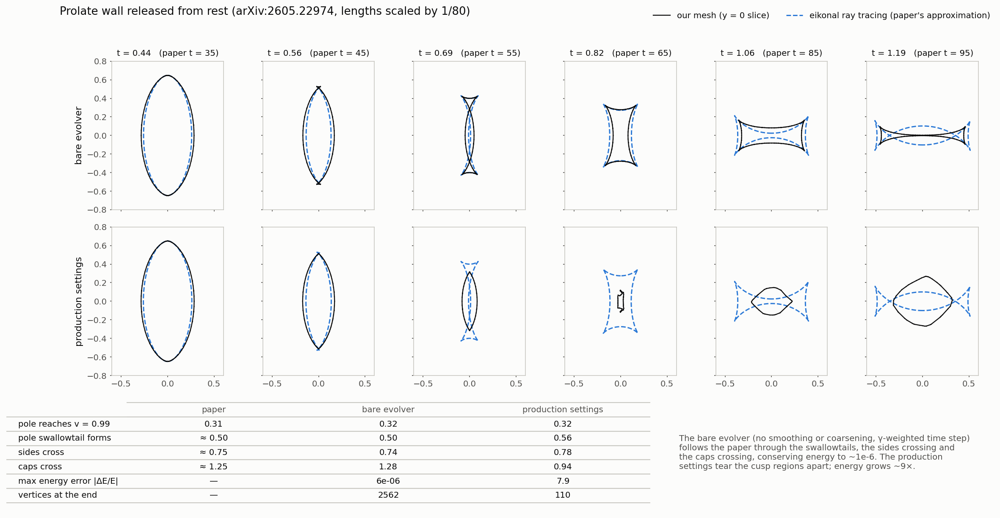
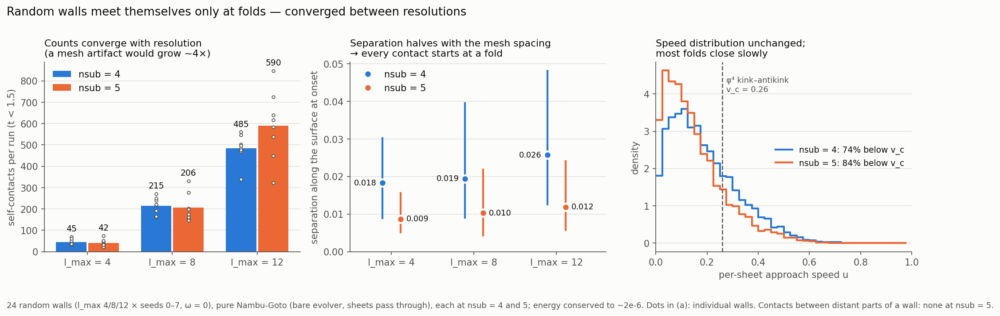

# ngwall — relativistic Nambu-Goto domain wall evolver

Evolves closed domain walls as relativistic Nambu-Goto membranes on a triangle
mesh, with intercommutation surgery when a wall touches itself, and drives
recursive fragmentation cascades.

The scientific question is the domain-wall analog of Copi & Vachaspati
([arXiv:1010.4030](https://arxiv.org/abs/1010.4030)): random string loops
fragment into stable, non-self-intersecting daughters. Do arbitrary closed
domain walls likewise cascade into stable remnants, or does every fragment
collapse? Strings never shrink; walls at rest collapse, so the endpoint may be
qualitatively different.

## Status (November 2026)

**The production census (144 runs, July 2026) is not valid.** A code review
with instrumented runs found:

- **Walls passed through themselves undetected.** A typical random wall first
  self-intersects at t ≈ 0.3, where it reaches v → 1 and folds over; the first
  contact is detected at t ≈ 0.9, with ~180 crossings already present. The
  folds lie within the detector's 4-hop exclusion, and vertex-pair detection at
  `d_c` (a fifth of an edge) lets sheets cross between vertices.
- **Surgery chose the wrong topology** in controlled tests: a clean neck pinch
  became a tunnel (genus 0 → 1), and a pressed pancake went to genus 26.
- **Almost no fragmentation happened.** 6859 of 6881 surgeries produced one
  wall; a typical run is one wall gaining handles until genus > 25 ("foam").
- **Tangential smoothing manufactures angular momentum** (|L| +1.7% in 0.4 time
  units on a spinning wall; RK4 alone conserves it to 1e-10).

**Cusps are physical.** Collapsing walls generically develop cuspidal edges
and swallowtails from smooth initial data, and lattice field theory follows
Nambu-Goto through them
([arXiv:2509.19457](https://arxiv.org/abs/2509.19457),
[arXiv:2605.22974](https://arxiv.org/abs/2605.22974)). The bare evolver — no
smoothing, no coarsening, γ-weighted time step — reproduces the latter
paper's prolate-ellipsoid collapse through its cusps (event times within
~2–4%, energy to 2e-6); the production settings do not.

*Prolate wall from arXiv:2605.22974: the bare evolver (top) follows the paper
through its cusps; the old production settings (bottom) do not.*

**Approach-speed census: walls self-intersect only at folds.** The 144
production initial conditions were evolved as pure Nambu-Goto with the bare
evolver (sheets pass through each other) to t = 2, plus a resolution check: 24
of them at both nsub = 4 and nsub = 5 to t = 1.5 (`diagnostics/`,
`data/approach_census*/`).

- **Separate parts of a wall almost never meet.** There were 16 such contacts
  in 144 runs, 15 of them faster than the φ⁴ kink-antikink v_c ≈ 0.26 (so they
  would pass through rather than reconnect), and none at nsub = 5.
- **Every other contact is a fold.** These are the 45–590 contacts per run,
  rising with `l_max`. The along-surface separation of the two sheets halves
  with the mesh spacing, so it vanishes in the continuum; these are
  swallowtail-type self-intersections growing out of caustics. Their counts
  converge with resolution (per run, nsub 4 → 5: 45 → 42, 215 → 206,
  482 → 589 for `l_max` 4, 8, 12).

*Resolution check: self-contact counts converge, the sheets' separation at
contact halves with the mesh spacing (every contact starts at a fold), and the
closing speeds are unchanged.*

**So random closed walls do not undergo Copi-Vachaspati-style reconnection:
they collapse through folds.** Two questions remain open: what the overlapping
fold region does in field theory (annihilate? radiate how much?), and
whether folds pinch off separate pockets of one vacuum without any
reconnection.

## Layout

| Path | Role |
| --- | --- |
| `membrane.py` | Mesh evolver: RK4, tangential smoothing with energy rescale, edge-collapse coarsening |
| `contact.py` | Self-contact detection: KDTree vertex pairs within `d_c`, k-ring exclusion, opposing-normal test, clustering |
| `surgery.py` | Intercommutation: excision, validity-constrained min-area caps and tubes, dilation retries |
| `run_cascade.py` | Recursive population driver; fragmentation trees, retirement causes, census records |
| `run_random.py` | Random initial data: flat-spectrum harmonics `l=2..l_max`, shape `eps`, normal velocity `v_amp`, optional spin `omega` |
| `testbeds.py` | Test geometries (kicked dumbbell, torus, pancake) and the exact sphere solution |
| `vtk_out.py` | ParaView output (per-snapshot faces, since topology changes) |
| `diagnostics/` | Ellipsoid benchmark against arXiv:2605.22974; approach-speed census (v2) with resolution comparison; Sol job script |
| `test_fixes.py` | Regression tests for the numerical guards and a cascade smoke test |
| `data/census/` | Census JSONs: `prod_*` (144 production runs), `random_*` (12 earlier pilot runs) — from the invalid runs, kept for reference |
| `data/states/` | Terminal mesh states of those runs; records' `state_file` fields name the old root location, so look files up by name here |
| `data/approach_census/` | Approach-speed census v1: 144 runs, nsub = 4, to t = 2 |
| `data/approach_census_v2/` | Census v2 resolution check: 24 initial conditions × nsub 4 and 5, to t = 1.5 |
| `figures/` | README figures; regenerate with `diagnostics/plot_*.py` |

## Numerical behaviour

- RK4 conserves energy to ~1e-9 and angular momentum to ~1e-10 in smooth
  evolution, and matches the exact spherical collapse.
- `tangential_smooth` restores energy after each pass by a global rescale of
  the proper velocity. The resulting ~1e-9 energy conservation is enforced, not
  measured; the rescale inflates |L| and P. At cusps the pass is not gauge and
  can change energy by 10–100% per pass.
- `collapse_short_edges` conserves momentum exactly and reports its energy
  change as dissipation. At a fixed absolute `lmin` it erases cusp structure
  where the wall compresses, and nothing refines the mesh again.
- Surgery output is checked to be a closed manifold (no duplicate faces, every
  edge in exactly two triangles, even Euler characteristic).
- The bare evolver (no smoothing or coarsening, γ-weighted time step,
  `diagnostics/ngtools.gamma_dt`) conserves energy to ~1e-6 through cusps and
  reproduces arXiv:2605.22974's prolate collapse.

## Open issues

1. Contact detection works on vertex pairs and cannot see sheets crossing
   between vertices or folds near cusps.
2. Surgery decides tube-vs-cap with a mean-normal heuristic instead of the
   topology of the excised region.
3. The smoothing energy rescale does not conserve L or P and fails at cusps.
4. No mesh refinement: stretched regions lose resolution.
5. Once sheets may pass through each other, a "fragment" must be defined by
   vacuum domains, not mesh connectivity.
6. Census bookkeeping: JSON written only at the end of a run; state filenames
   embed the full wall id (the 255-byte limit is reached near depth 112);
   records of walls ending in surgery lack `L1`/`P1`/`I1`; seam-coarsening
   energy after surgery is not recorded.
7. Initial data: a flat spectrum per (l, m) at fixed RMS `eps` puts power
   ∝ 2l+1 per l, so `l_max=12` walls are far more crumpled and energetic than
   `l_max=4`; CV instead fix the loop length.
8. The crossing search in `diagnostics/ngtools.py` needs more than 4 GB late
   in a collapse at nsub = 5; its candidate search should be chunked.

## Next

1. Figures (census summary, ellipsoid benchmark), and a discussion with the
   advisor.
2. Vacuum pockets: under pass-through evolution, do folds pinch off separate
   regions of one vacuum?
3. Field-theory (φ⁴ lattice) test of a folding wall: does the fold overlap
   annihilate, and how much energy does it radiate?
4. Rebuild the evolver around the result: bare evolver through cusps,
   angular-momentum-conserving fix, refinement, bounded memory, tests; add a
   fold-trimming model only if field theory requires one.
5. Production runs on Sol and the write-up; an expanding-universe (FLRW)
   version later.
